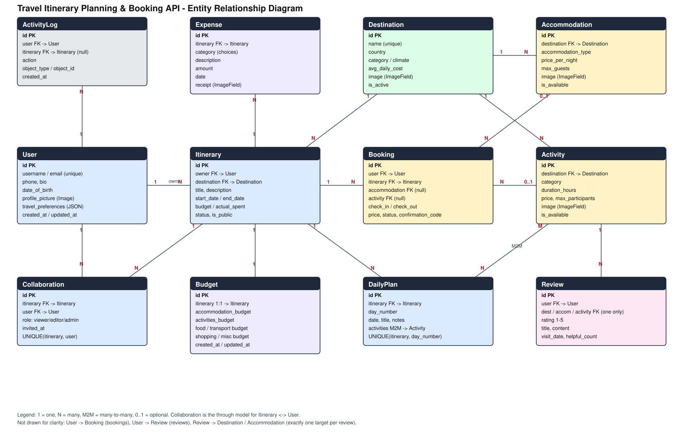

# Travel Itinerary Planning & Booking API

Django REST Framework API with six apps: accounts, destinations, itineraries, bookings, budgets and reviews. SQLite is the local default; PostgreSQL connection settings are supported.

## Setup (PowerShell)

Run from this directory (the one containing manage.py):

```powershell
py -3.13 -m venv venv
.\venv\Scripts\Activate.ps1
python -m pip install -r requirements.txt
Copy-Item .env.example .env
python -c "from django.core.management.utils import get_random_secret_key; print(get_random_secret_key())"
# Paste the generated value into SECRET_KEY in .env.
python manage.py migrate
python manage.py createsuperuser
python manage.py runserver
```

On Linux/macOS use python3 to create the environment, source venv/bin/activate, and cp .env.example .env.
Existing installations that already have budgets/reviews tables without migration records should back up the database, verify those tables match the initial migrations, then use python manage.py migrate --fake-initial. Fresh databases use ordinary migrate.

## Configuration

DEBUG defaults to False. Outside local DEBUG mode, SECRET_KEY must be explicitly configured, at least 50 characters, randomly generated, and must not start with django-insecure-. Local DEBUG mode can generate an ephemeral key if none is supplied; set a stable local key to keep tokens valid across restarts. Never commit .env or credentials.

ALLOWED_HOSTS and CORS_ALLOWED_ORIGINS accept comma-separated values. Database variables are DB_ENGINE, DB_NAME, DB_USER, DB_PASSWORD, DB_HOST, DB_PORT; DATABASE_URL is not used. DB_NAME defaults to the local db.sqlite3 file. Use django.db.backends.postgresql as DB_ENGINE for PostgreSQL.

Password reset sends email through EMAIL_BACKEND. The example uses the console backend for local development. Configure EMAIL_HOST, EMAIL_PORT, EMAIL_HOST_USER, EMAIL_HOST_PASSWORD, EMAIL_USE_TLS and DEFAULT_FROM_EMAIL for deployed SMTP delivery.

## Authentication and permissions

POST /api/v1/accounts/register/ creates the account; it does not return JWTs. POST /api/v1/accounts/login/ with username and password returns access and refresh tokens. Send Authorization: Bearer <access>. Refresh at /api/v1/accounts/token/refresh/.

Trip owners and collaborators can edit and publish itineraries; viewers can read them. Only the owner can add collaborators. Bookings, daily plans, budgets and expenses are owner-only, including submitted relationship IDs. Review authors can edit/delete their own reviews. Staff manage destinations, accommodation/activity catalogues and destination photos. Public catalogue and review reads are allowed.

## Registered routes

All paths below start with /api/v1/. CRUD means list/create and retrieve/update/delete on the ID route.

| Resource | Routes and methods |
|---|---|
| Accounts | POST accounts/register/, accounts/login/, accounts/token/refresh/, accounts/change-password/; GET/PATCH accounts/me/, accounts/profile/ |
| Reset | POST accounts/password/reset/ with email; POST accounts/password/reset/confirm/ with uid, token, new_password, new_password_confirm |
| Destinations | CRUD destinations/; GET destinations/featured/, destinations/search-advanced/, destinations/{id}/photos/; POST destinations/{id}/upload-photo/ |
| Catalogue | CRUD accommodations/, activities/; GET categories/, tags/ and their ID routes |
| Itineraries | CRUD itineraries/; POST itineraries/{id}/add-collaborator/, publish/, duplicate/; GET itineraries/{id}/summary/ |
| Search/report | GET/POST itinerary/search/; GET itinerary/{id}/report/ |
| Daily plans | CRUD daily-plans/; creation requires itinerary, day_number and date |
| Bookings | GET/POST booking/accommodation-bookings/, booking/activity-bookings/; GET/PUT/PATCH/DELETE each {id}/ route |
| Bulk bookings | GET booking/bulk-update/ returns supported types/statuses; POST accepts bookings: [{type, id, status}] and returns per-item successes/failures |
| Reviews | CRUD reviews/, activity-reviews/; GET destinations/{id}/reviews/ |
| Budgets | CRUD budgets/; GET budgets/{id}/summary/; GET/POST budgets/{id}/expenses/ (URL determines parent) |
| Expenses | CRUD expenses/ |

Reset requests return the same response for known and unknown addresses. Tokens expire under Django's PASSWORD_RESET_TIMEOUT and become invalid after successful use. Reset endpoints are throttled to five anonymous requests/hour per IP using the configured Django cache. Configure a shared cache and trusted proxy settings for multi-process deployments.

GET itinerary/search/?q=... searches accessible trips; POST stores the query as profile search preferences. Destination filtering supports q (custom name/city/description filter), country, city, category, tag and rating bounds. Advanced search validates min_rating from 0 to 5. Lists support pagination, ordering and the search fields configured by each view. Expense pages use a smaller page size.

## Examples

Registration JSON:
```json
{"username":"traveler1","email":"t@example.com","password":"StrongPass123!","password_confirm":"StrongPass123!"}
```

Itinerary creation JSON:
```json
{"title":"Paris Trip","start_date":"2027-11-01","end_date":"2027-11-07","budget_estimate":"2500.00"}
```

Search destinations: GET /api/v1/destinations/?country=France&ordering=-avg_rating.

## Tests and documentation

```powershell
python manage.py check
python manage.py test
python -m coverage run manage.py test
python -m coverage report
# Alternatively: pytest --cov --cov-report=term-missing
```

Tests use a separate temporary database. .coveragerc excludes test code and migration files from application coverage. See VALIDATION.md for the measured result and PLANNING.md for design and feedback mapping.

Swagger: /api/docs/; ReDoc: /api/redoc/; schema: /api/schema/. ERD: [erd.svg](erd.svg).


